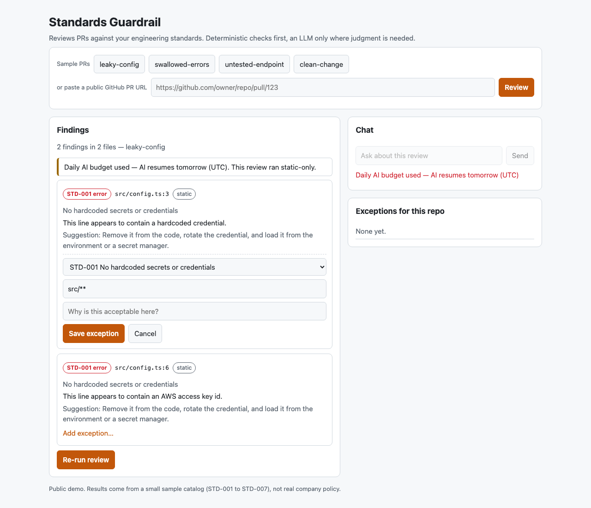

# Standards Guardrail

Reviews a GitHub pull request against a written engineering standards catalog, explains each violation, suggests a fix, lets you chat about the findings, and remembers deliberate exceptions. Live at https://cf-ai-standards-guardrail.nareshnavinash.workers.dev (public PRs only, free Cloudflare plan).



The screenshot was taken from a local run with the AI budget at zero, so it shows the static-only mode (see below).

I built it as a small working version of "turn engineering standards into automated guardrails and feedback engineers can act on, instead of checklists and manual review". The design note is in [docs/superpowers/specs](docs/superpowers/specs/2026-11-24-standards-guardrail-design.md), the plan in [docs/superpowers/plans](docs/superpowers/plans/2026-11-24-standards-guardrail.md), and the prompts I used to build it are in `PROMPTS.md`.

## Try it in 60 seconds

1. Open the live URL and click **leaky-config**. You get STD-001 findings in a couple of seconds.
2. Click **Add exception...** on a finding. The rule and the directory glob (`src/**`) are pre-filled; add a reason and save.
3. Click **Re-run review**. The finding moves under "Suppressed by exceptions".
4. Paste any public PR link (for example `https://github.com/honojs/hono/pull/5669`) instead of a sample.
5. When the daily AI budget is available, the chat panel answers questions about the review ("why is this a problem?", "show me a fix").

## Architecture

```
 Browser (static assets: index.html, app.js, styles.css; CSP, text-only rendering)
    |  JSON over fetch, polls every 1.5 s
    v
 Worker (src/router.ts)  -- validates input, fetches the diff from GitHub, rate limits, claims a budget slot
    |                \
    |                 \--> CONTROL Durable Object (SQLite, one global instance)
    |                      review index, in-flight dedupe, daily + per-IP counters, neuron reservations
    v
 REVIEW_WORKFLOW (Cloudflare Workflow, src/workflow.ts)        <-- COORDINATION
    parse -> cache-lookup -> static-checks (STD-001..004)
          -> llm-check:<file> x N, 4 in parallel, 2 retries    <-- LLM: Llama 3.3 70B on Workers AI (STD-005..007)
          -> cache-store (KV, full reviews only)
          -> apply-exceptions  (reads memory)                  <-- MEMORY
          -> persist (saves the result)
                                                               
 REPO_MEMORY Durable Object (SQLite, one per repo+visitor)     <-- MEMORY
    exceptions, saved reviews, chat history

 POST /api/reviews/:id/chat  -> Worker -> Llama 3.3 with findings + flagged code + last turns   <-- CHAT
```

The four pieces the assignment asks for, and the job each does:

| Piece | What it does here |
|---|---|
| LLM | Llama 3.3 70B judges the three rules that need judgment (STD-005 to STD-007) and answers chat questions. |
| Workflow | One Workflow per review: durable, retried steps, with a file whose LLM step fails marked as degraded rather than failing the review. |
| Chat | A chat panel explains findings and proposes fixes. It cannot change code or add exceptions. |
| Memory | A SQLite Durable Object per repo and visitor stores exceptions, saved reviews and chat history. A global Control Durable Object holds budget state. |

**Request flow.** The Worker validates the input and loads the diff (sample or GitHub API) before it starts anything, so a bad URL, an issue link, a private repo or an oversized diff fails fast with a specific message and never starts a Workflow. It then claims a review slot atomically in the Control Durable Object and starts the Workflow, which runs the steps above. The UI polls for the result, which is read back from the repo Durable Object, so a review link keeps working after the Workflow instance expires.

## Why static first

An LLM should not do what a regex does reliably. Secrets, empty `catch` blocks, TODOs without a ticket, and "source changed but no tests" are checked deterministically (STD-001 to STD-004). They are free, instant, identical on every run, and immune to prompt injection. The LLM only gets the three rules that need judgment: outbound calls without a timeout, user-facing errors that leak internals, and logs with PII. Its output is constrained to a JSON schema, rule ids and line numbers outside the catalog and the added lines are dropped, the diff is wrapped as data, and static findings never depend on the model. A test file is never sent to the LLM.

## Degraded and static-only modes

- **Degraded.** If a file's LLM step still fails after retries (bad JSON, truncation, quota), that file is listed as "LLM check unavailable", its static findings are kept, and the result is not cached. A review only fails when the input itself is unusable.
- **Static-only.** When the daily AI budget (or a per-IP allowance) is used up, new reviews run with the deterministic checks only, the UI says so with a banner, and chat answers "AI resumes tomorrow (UTC)". Cached diffs cost nothing and still return full results. The Playwright suite runs the whole app in this mode.

## Exceptions are deliberate, scoped records

An exception is a rule id, a path glob and a reason, added with an explicit button on a finding. It is not inferred from chat, because a guardrail's exceptions must be auditable. Exceptions are applied after the cache, so a new one takes effect on the next run. They are **visitor-scoped**: memory is keyed by `<repo>#<visitorId>`, so on a public demo nobody can hide findings from other people. Catch-all globs (`*`, `**`, `**/*`) are rejected, globs are capped at 100 characters and matched in linear time (no regex built from user input), and there is a cap of 25 per repo. Without a valid visitor id a visitor is read-only. If browser storage is blocked, the id lives in the tab and the UI says "Exceptions last only for this tab".

A plain Durable Object, not the Agents SDK: it gives the same per-repo stateful identity with less API surface and version risk on a same-day deadline. Polling every 1.5 s is enough for a 5 to 60 second review, so there is no WebSocket either.

## Free-plan budget design and known limits

The app runs on the Cloudflare free plan: roughly 10,000 Workers AI neurons per day (about 12 full reviews with the 70B model), about 10 ms CPU per invocation, 1,000 KV writes per day, and about 3 days of Workflow retention. The design works inside that:

- **Neuron budget.** Every AI call first reserves its worst case (prompt size at the input rate plus `max_tokens` at the output rate) in the Control Durable Object, then settles to the real usage. A refused reservation means no AI call. `DAILY_NEURON_BUDGET` is 9,000, leaving 1,000 of headroom under the free allowance. `max_tokens` is 1,024 for checks and 600 for chat.
- **Count caps.** 10 LLM reviews and 40 chat turns per UTC day, 10 chat questions per review. Per IP (salted hash): 30 review requests, 4 LLM reviews and 15 chats per day. Rate limits per minute: 5 reviews and 10 chat or exception writes.
- **Cheap by construction.** Results of full, non-degraded reviews are cached in KV for 30 days (so samples are free after the first run); KV is not used for counters because of the 1,000-writes limit. Diffs are limited to 100 KB, 10 files, 300 added lines per file and 12 KB of code per file sent to the model.
- **Other protections.** Private repos are refused, strict CSP and text-only rendering, errors are JSON with a code and never leak internals, and a dead Workflow releases its slot.

Known limits, accepted:

- A Workers AI transport error is settled to 0 neurons. If the model actually ran before the connection dropped, the count is slightly low; the 1,000-neuron gap absorbs it.
- A step retried after it already settled a positive amount is not re-checked against the budget before its AI call (its spend is added afterwards). It is bounded by one file's worth of tokens per retry.
- `wrangler dev` always talks to the remote AI binding, which can incur usage even locally.
- The catalog is a seven-rule demo, not real policy.

## Evals

27 hand-labelled cases: 22 synthetic and 5 from real public PRs (hono, express, fastify). Details, per-case results and the limits of this eval are in [evals/RESULTS.md](evals/RESULTS.md).

| Rules | Mode | Cases | Result |
|---|---|---|---|
| STD-001, STD-002, STD-003 | static | 27 | precision 1.00, recall 1.00 each |
| STD-004 | static | 27 | precision 0.75, recall 1.00 (one false positive on a comment-only PR, recorded on purpose) |
| STD-005, STD-006, STD-007 | LLM, run once | 8 | 3 of 3 positives found, 5 of 5 negatives silent, none degraded |

These are smoke-test numbers: small n, one author who also wrote the labels, and mostly synthetic cases. The LLM rules saw one positive each. The results file lists what this eval does not show.

## Run it

```bash
npm install
npm test               # unit tests (vitest)
npm run typecheck
npm run test:e2e       # Playwright: starts wrangler dev with the AI budget at 0, static-only, no neuron spend
npm run eval           # all eval cases, static-only, against EVAL_BASE_URL (default http://localhost:8787)
npm run eval -- --llm  # only the LLM cases, spends neurons: run it sparingly
npm run dev            # local Worker; needs `npx wrangler login` and a .dev.vars file with GITHUB_TOKEN
```

The first `test:e2e` needs the browser once: `npx playwright install chromium`. The e2e suite uses `wrangler.e2e.jsonc` (same bindings, no rate-limit bindings, budget 0) and a throwaway state directory.

`npm run eval` reads `EVAL_KEY` from the environment or from a gitignored `.eval-key` file. `PROMPTS.md` is generated from Claude Code session logs with `node scripts/export-prompts.mjs --modified-on <date> --match <text> --runtime --out PROMPTS.md <log dir>` (flags are documented at the top of the script).

## Deploy

```bash
npx wrangler login
npx wrangler kv namespace create CACHE      # put the id in wrangler.jsonc
npx wrangler secret put GITHUB_TOKEN        # fine-grained PAT, public repositories read-only, no permissions
npx wrangler secret put EVAL_KEY            # random value; enables the eval route
npx wrangler deploy
curl https://<your-worker>.workers.dev/api/health   # {"ok":true,"githubToken":true}
```

The GitHub token is required: unauthenticated calls share Cloudflare's egress IPs and hit GitHub's 60 per hour limit almost immediately. Moving to the Paid plan would raise the CPU limit, lift the Workers AI daily allowance (billed per neuron), allow more KV writes, and keep Workflow instances longer; the budget variables in `wrangler.jsonc` are the only knobs to change.

## What I would do next

- **GitHub App.** Comment the findings on pull requests (webhook with signature check, one upserted summary comment) so the feedback lands where engineers already work.
- **MCP tool.** Expose `list_rules` and `review_diff` so an AI coding assistant can check its own change before opening the PR.
- **Policy as code.** Export the catalog as a config and make rules pluggable per repo, with static rules compiled from the same file.
- **Compliance dashboard.** Counts of which rules fire most and which get exceptions most, to see where a standard is unclear or too strict.
- **Better evals.** A second labeller, more real PRs, line-level scoring, and a regression run in CI.
